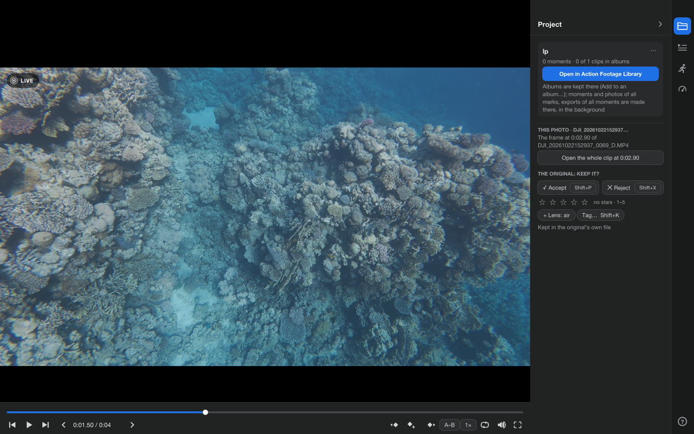

# Live photos in the player

**Status:** built in #267 (v0.14.0); parts not built: the HDR still on Windows and Linux.

The player shows a photo the way a phone does (the `live-photo` plugin, `mpv/scripts/live-photo/`).

## What you see

- A photo (HEIC, JPEG, PNG, …) opens as the picture on the whole window and stays there: no slideshow, nothing
  plays.
- A **live** photo has the Live icon in the picture's top-left corner: macOS's circle of rays (the Library's tiles
  draw the same shape) and the word LIVE, in a dark pill.
- **The mouse over the icon** plays the live part, with its sound (at the player's volume; muted stays muted), as an
  iPhone or a Mac does: from the photo's own frame to the end of the video, then round again from its start, for as
  long as the mouse stays. The pill turns white while it plays. The mouse off the icon: the picture again.
- **Space** does the same from the keyboard as a switch: on, round and round, and Space again (or Esc) back to the
  picture (only while a live photo is shown; on a clip Space pauses as before).
- A plain photo has no icon. Previous / Next (and the side panel's Playlist, which now lists photos too) go through
  photos and clips as through any playlist.
- What is for clips only does nothing on a photo: stabilization keys (Ctrl+g, Ctrl+k, Ctrl+b, Ctrl+u, Ctrl+j,
  Ctrl+a), Export (E), Save frame / photo (Alt+s, Alt+S, c), Open in Gyroflow (Ctrl+e), the clean frame (Ctrl+p,
  Ctrl+f), moments (k), the cut (Ctrl+x), marks (M), the 360 recording (Alt+r). The side panel hides Source,
  Transform, Output, Save frame, Dolby Vision and 360° view while a photo shows (and comes back to the part you had on
  the next clip). Tags and ratings still work on photos.

### HDR

A photo with a gain map (an iPhone's HEIC, an Ultra HDR JPEG such as a Pixel's, the player's own photos in the HDR
look) is shown in HDR on an HDR screen, **as macOS shows it** (Preview, Photos):

- mpv itself decodes only a photo's SDR image. The gain map is applied by macOS: Core Image's `expandToHDR` (the
  system's own decoder; ImageIO's `kCGImageSourceDecodeToHDR` gives the same picture) in the gyroflow plugin's
  `afp-photo --hdr-still`. It writes the HDR rendition once, as a 10-bit HEIF in PQ BT.2100 (SDR white at 203 nits, the
  gain map's full headroom), into `~/Library/Caches/ActionFootagePlayer/hdr-stills/`. That takes 0.2–0.5 s the
  first time; the SDR image shows meanwhile.
- The plugin adds it as another picture track of the photo and shows it in the SDR image's place. Its frames are
  labelled PQ, BT.2020 and full range (`vf format`, labelled `live-photo-hdr`), because mpv assembles a HEIF's
  512-pixel tiles into one picture without those tags. While it shows, the display is switched to HDR (target PQ),
  as the dlogm plugin does for HDR video.
- Measured: what mpv decodes from the rendition matches Core Image's own HDR rendering of the photo to 1.3–2.2 PQ
  codes out of 1023 on average (10-bit compression), on an iPhone 14 Pro HEIC and on the player's own HEIC and Ultra
  HDR JPEG.
- On an SDR screen (the dlogm plugin's `user-data/dlogm/screen`), the photo's own SDR image shows, as Preview shows
  it there. When the window moves between screens, the still follows.
- The live part plays its own video (SDR, HLG or Dolby Vision as it is) under the same HDR target.
- **Not the same as Preview in one way:** Preview applies the gain map for the screen's headroom at the moment. Here
  the whole gain map is applied, and mpv's renderer fits it to the screen. On a screen with at least the photo's
  headroom (an XDR display) the two match; on a dimmer one, mpv's tone mapping does the fitting.
- **Not on Windows or Linux yet**: the photo's SDR image there (see the PR for Windows' options).

## Which photos are live

- **Live Photo** (Apple): the photo and a `.mov` of the same name beside it (`.mov` or `.MOV`). When both say which
  Live Photo they are (the MOV's `com.apple.quicktime.content.identifier`, the same UUID in the photo's maker note),
  they must agree; one that doesn't say is paired by its name, as the Library does. The `.mov` is taken out of the
  playlist when its photo is in it (only a `.mov` that is a Live Photo's video: with Apple's keys, a still time, or
  6 s or shorter, so a camera's clip beside a JPEG of its own stays).
- **Motion Photo** (Android, and the player's own export): a JPEG (or HEIC) whose XMP says `GCamera:MotionPhoto="1"`
  with a `Container:Directory` whose `MotionPhoto` item gives the video's length (counted from the file's end), or the
  older `GCamera:MicroVideo` with `MicroVideoOffset`. mpv plays the video straight out of the JPEG
  (`slice://<offset>@<file>`): nothing is copied.
- **A photo's link** from the Library (`<name>.afplink.jpg`, a frame of a clip) is live too: see below.

## Chains: photos taken in a row

When photos are taken quickly one after another, their live parts overlap in time. While the mouse stays on the icon
(or Space has it on), the player carries on, and at the run's end goes round again from its start:

1. **When each live part happened.** A photo's capture time is its Exif `DateTimeOriginal` +
   `SubSecTimeOriginal` (+ `OffsetTimeOriginal`). The still is the video's frame at the *still time*: a Live Photo's
   MOV says it in its `com.apple.quicktime.still-image-time` metadata track (when its one sample is, e.g. 1.33–1.93 s
   on an iPhone 14 Pro), a Motion Photo in `GCamera:MotionPhotoPresentationTimestampUs`. So the live part runs from
   *capture time − still time* for the video's length.
2. **The next photo** is the live one taken next after this one (by capture time) whose live part has begun before
   this one's ends and goes on at least 0.1 s past it. Candidates are the playlist's photos around this one (4 before,
   12 after): the folder, or the list the Library opened. Both photos must have their capture times on the same kind
   of clock (both with a time zone, or both without). A photo whose live part ends with this one's adds nothing and is
   passed over.
3. **The jump** happens when this photo's video runs out: the next one's video goes on from the same moment
   (*this one's end − the next one's start* into it). Its sound comes with it.
4. **The end.** When no photo follows, the run ends: the player shows the photo it got to (that photo becomes the
   playlist's current one). Let go earlier, and it rests on the photo playing at that moment.

How well it lines up, measured by matching the videos' frames to each other:

- The player's own exports (a clip at 2.0, 2.9, 3.8 s): exact (0.901 s predicted, 0.901 s measured).
- An iPhone 14 Pro burst (2023, 9 photos 0.3–2.7 s apart): the frames are the same sensor frames, and the rule
  lands within 0.02–0.29 s of the right moment (median about 0.06 s), so a jump may step a few frames back or forward.

## Photo links: a frame of a clip

A photo's link plays like a live photo, the way a moment plays its part of the clip:

- It opens as its clip's part around the frame, as a video of its own (the workspace plugin's EDL, as for a moment:
  stabilized and in the clip's look as the clip is), **paused at the frame**: that is the still. The Live icon is on
  it; hover or Space plays the part, 1.5 s on each side of the frame (as long as an exported Live Photo's), with the
  clip's sound; let go, and it's back at the frame.
- **Runs**: links to the same clip (by its fingerprint, else its path) next to it in the playlist whose parts overlap
  play as one: the part opened is then from the first's start to the last's end, so it plays on without a break or
  a reload. Let go, or at its end, and the player rests on the link it got to, at its frame. Links of another clip,
  and real Live Photos, don't join a link's run (their times are on other clocks).
- **The whole clip is one button away**, as for a moment: *Open the whole clip at 0:12.35* in the side panel's
  Project part (*This photo*) and in the right-click menu. It opens the clip paused at the photo's frame, the live
  part marked as A–B (not looped), so Space plays on from there and the clip's moments, marks and exports are at hand.
- **Its own frame**: a link keeps Save frame's camera (turned, zoomed) and crop. Playing it, the gyroflow plugin turns
  the camera to the link's own (crop mode's camera, `crop.view`: the GPU warp's parameters) and crops the picture to the link's frame (mpv's `video-crop`, in shares of the picture), so the still and its
  live part look as Share renders the link (`gyroflow-export --camera --crop`). Checked headless against Share's render on the
  VapourSynth filter before #304: no shift, edge correlation 0.78 (the same link without its camera: 0.05, off by
  ~700 px); not re-run on the GPU path yet (`tests/photo_link_frame.py`). The whole clip opens as the clip is, without the link's frame.
- A photo **the player made** (Save frame: a HEIC, Live Photo or Motion Photo with the link in its XMP) has the same
  button when its clip is where the link says.
- While a photo shows, the panel's Project part shows *This photo* and its button, not the clip's marks, moments or
  selected part (those are the clip's: open it).
- **A photo's Accept / Reject, stars and tags are its own**, as a moment's: its pick and rating in its link, its tags
  in its XMP (`dc:subject`), written by afp-meta as the Library writes them. The panel says *This photo: keep it?*.
  A photo without a link (an iPhone's) isn't tagged in the player.
- **The Library's tiles** show the Live icon on a photo link, a Live Photo and a Motion Photo: everything the player
  plays as a live photo.

## Opening photos

- **Library**: a double click (or Open) on a photo opens it in the player like a clip: in the list the window shows
  (the Library's list as the playlist, `workspace/librarylist.lua`), at its place, photos and videos together. The run
  of a live photo then goes through that list's photos, not the folder's.
- **Finder**: the Quick Action **Play Live Photo** (for images; installed with the others by `setup.sh quick-actions`
  into `~/Library/Services`). The player is not made the default app for HEIC or JPEG.
- **Windows Explorer**: **Play Live Photo** in the menu of `.heic`, `.jpg` and `.jpeg` files (on Windows 11 under
  Show more options), as the installer adds Play / Stabilize + LUT for videos. No file association either.

## For tests

The plugin's script messages: `live-photo-view play|stop` (what the hover and Space do), `live-photo-dump <file>`
(what it knows, the run, the icon's place and its ASS), `live-photo-layout w h scale [ml mt mr mb]` (lays the icon out
for a window that size: a player without a window has no OSD). Other plugins read `user-data/afp/photo`
(`{ live, kind, playing, step, run, at }`, unset for a clip).

- `luajit tests/live_photo_test.lua`: the readers and the chain rule; with `AFP_LIVE_PHOTOS=<folder>` and
  `AFP_MOTION_PHOTOS=<folder>`, real files too.
- `MPV=<mpv> python3 tests/live_photo_ipc.py <folder of photos taken in a row> [<a plain photo>]`: the plugin in a
  player without a window, over IPC: the still, the hover, Space, the run.
