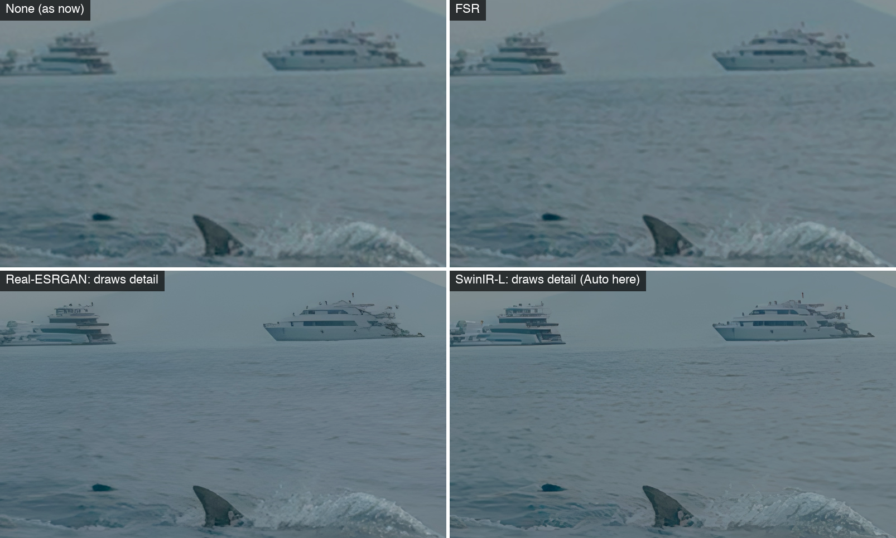
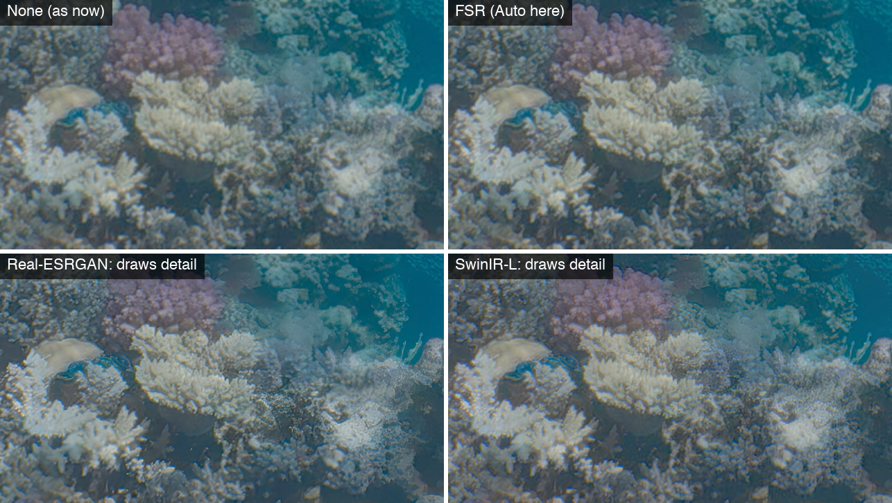

# Photo upscaling

A photo cut from a zoomed-in part of the frame (Save frame's camera zoomed, a small frame) has fewer of the camera's
pixels in it than it is saved with: the stabilization's warp stretched them, with its Lanczos, as it plays. The
photo's **Upscale** choice (Save frame panel, `gyroflow.conf`'s `photo_upscaler`, `gyroflow-export --upscale`) says
what makes the missing ones:

| Choice | What it does | Where | Strong crop: 1920x1080 from 769x433 source pixels | Weak: 1536x864 from 1084x610 |
|---|---|---|---|---|
| None | the warp's own interpolation, as the player always did | everywhere | — | — |
| FSR | AMD's FSR 1, the player's `fsr.glsl` (EASU + RCAS): edges kept sharp, nothing added | everywhere | 0.05 s | 0.2 s |
| Real-ESRGAN | Real-ESRGAN x4plus, a neural network: **draws detail that wasn't in the frame** | macOS | 6 s | 9 s |
| SwinIR-L | SwinIR-L real-world x4 (GAN), a neural network: **draws detail that wasn't in the frame** | macOS | 31 s | 36 s |
| Auto (default) | none when the crop isn't stretched, FSR for a weak stretch, SwinIR-L for a strong one | | | |

(The upscale step alone, on an M1 Pro, models already downloaded; the rest of a photo takes its ~1-2 s as before.)

The neural ones are trained to turn a soft, noisy picture into a crisp one, and where the picture has no detail
they draw plausible texture, sometimes things that were never there. On the dolphin clip's yachts (2026-11-16 probe)
Real-ESRGAN drew portholes and a tree-like shape, SwinIR-L turned the decks into rock. The panel and this page say
so; they're for a picture you want crisp more than true.

Seen on Anton's clips (each at 100 %, brightened for viewing; `docs/img/photo-upscaling/`): a strong crop, the
dolphin clip with Save frame's camera at 160 % (stretch 2.50, Auto: SwinIR-L), and a weak one, the coral clip's middle
(stretch 1.42, Auto: FSR).

## The stretch, and Auto

The stretch is output pixels per source pixel across the crop. `upscale::stretch` takes a 64x36 grid of the source's
pixels through the lens correction and stabilization as gyroflow renders the photo (the view's parameters, the
camera's turn and zoom applied: `undistort_points_with_rolling_shutter`), and of the cells that land in the crop takes
the median of sqrt(area in the output / area in the source). Checked against the picture itself: SIFT matches between
a rendered photo and the decoded frame gave 1.90 in the middle and 2.17 at the left edge, the measure 1.90 and 2.19.

What it is for Anton's clips (Action 6, 4K, medium level):

| Frame | Stretch |
|---|---|
| Dolphin clip 0102 above water, whole frame, no zoom | 1.90 in the middle, 2.2-2.25 at the edges, 1.98 over the frame |
| Coral clip 0021 under water, whole frame | 1.34 (1.42 in the middle) |
| Dolphin clip, Save frame's camera at 160 % (zoom 0.78) | 2.50 |
| Anton's sample photo of the probe | ~2.46 (1250 source pixels in 3072) |

So the lens correction and the stabilization's crop already stretch an unzoomed frame above water about twice; under
water the lens sees a narrower angle and stretches less. Auto's thresholds (`upscale.rs`):

- `WEAK_STRETCH = 1.1`: below it, nothing (the warp's pixels are about the camera's)
- `STRONG_STRETCH = 2.4` (Anton: start with these): from it on, SwinIR-L; between the two, FSR. Not 2: an unzoomed photo above water would
  flip between FSR and SwinIR-L around 2 by where it's framed, and only a real zoom should start a minute of drawing.

Off macOS Auto is FSR past 1.1.

## The neural path

1. The crop as the photo renders it (the GPU path's screenshot or gyroflow-export's own render), shrunk by its stretch
   with Lanczos to the source's own density: the pixels the camera has there.
2. The model, once, on the SDR rendition (what it was trained on: an sRGB picture), x4.
3. Lanczos to the photo's size.
4. The HDR rendition (HLG) from the upscaled SDR: at the source's density, per pixel and color, the ratio of HLG's
   scene light to the SDR's light, in stops; scaled up smoothly (bilinear) and laid on the upscaled SDR
   (`upscale::hdr_from_sdr`, exact at the same size). The gain map then follows the picture's light, not the texture
   the model drew, and a highlight clipped in SDR (the splash, the sun on the water) keeps its HDR from the ratio.

The photo's summary line says what was done: `stretched 2.50x, SwinIR-L (draws detail)`. A failure (no model, no
helper) leaves the photo as the warp drew it, and says why.

## FSR for a still

The same `fsr.glsl` the GPU path uses to the screen (PR #244), run by `user_shader.rs` on wgpu: the crop shrunk to the
source's density, as RGB into MAIN (`Shaders::render_rgb`), OUTPUT the photo's size; EASU and RCAS run as libplacebo
runs them for a target bigger than the picture, at most twice each way, and Lanczos does the rest. Each rendition on
its own (FSR adds nothing, so the HDR can't get texture the SDR hasn't), sharpness 0.2 as the player's default.

## The runtime: afp-upscale (macOS)

No Python, no PyTorch in the app. `macos/upscale.swift` is `afp-upscale`, beside `afp-photo`: Core ML on the GPU
(`cpuAndGPU`), the picture in the model's fixed tiles (256 for Real-ESRGAN, 192 for SwinIR-L), each read with 16
pixels around it and only its own part kept, progress on stderr. gyroflow-export runs it and passes the progress on
to the player (`--progress`), which shows "drawing detail, 40 %" while the photo saves; the player doesn't wait.

The models are Core ML conversions made by `tools/upscalers/convert.py` (coremltools 9, float16, an ML Program for
macOS 13+), 31 and 52 MB zipped. They're kept out of git and out of the app: afp-upscale loads them from
the app's data folder, `~/Library/Application Support/ActionFootagePlayer/models/` ($AFP_MODELS_DIR), compiles each
once (`.mlmodelc` beside it). `upscale::ensure_model` fetches a missing one on first use, zipped, with progress and its
SHA-256 checked (`MODELS`), from `MODELS_URL`: the repository's `upscaler-models` release, a pre-release kept apart
from the app's versions as `windows-deps` is, its notes saying where each model comes from and under which license
($AFP_MODELS_URL points it elsewhere for a test). A new conversion means new zips there and new checksums in `MODELS`.

The Neural Engine was tried: compiling Real-ESRGAN's graph for it took more than ten minutes and SwinIR-L's did not
finish in more than ten minutes either, so the GPU it is.

### Measured (M1 Pro, macOS 27, 1280x720 source pixels, `samples/photo_src_1280x720_hlg.png` of the probe)

| | Core ML (afp-upscale, GPU, fp16) | PyTorch MPS, same tiles (fp32) | PyTorch MPS, the probe's run.py |
|---|---|---|---|
| Real-ESRGAN x4plus (tile 256) | 14 s | 19.5 s | 16.4 s |
| SwinIR-L (tile 192) | 51 s | 121 s | 94 s |

Bigger tiles don't help: Real-ESRGAN at 512 took 13.4 s, SwinIR-L at 256 54 s. The first run after a download adds
the model's compile (a few seconds). PyTorch was measured with other sessions' work on the machine, Core ML on a
quieter one; the probe's 1.8 / 4.8 / 19.9 s for 456x404 pixels scale to about the same.

Against PyTorch with the same tiles the Core ML output is 62 dB (Real-ESRGAN) and 68 dB (SwinIR-L) PSNR apart, at most
9 and 4 levels of 255 in a pixel: float16 rounding. Against run.py (other tiles: 192 with 16 around, cut differently)
47 and 54 dB, the same as PyTorch against itself with the two tilings (the tiles' seams differ).

## Licenses

- afp-upscale, upscale.rs, convert.py: this project's (GPL-3.0-or-later).
- Real-ESRGAN (code and the x4plus weights): BSD 3-Clause, Copyright (c) 2021 Xintao Wang.
- SwinIR (code and weights): Apache License 2.0, Copyright 2021 SwinIR Authors (Jingyun Liang et al.).
- Each model's zip carries its project's LICENSE beside the package (`<model>.mlpackage.LICENSE`).
- FSR 1: MIT, AMD (in fsr.glsl).

The weights' training data is the authors' business, but worth knowing for a paid Library later: Real-ESRGAN x4plus
was trained on DIV2K, Flickr2K and OST; SwinIR-L's real-world model (`BSRGAN_DFOWMFC` in its name) on DIV2K, Flickr2K,
OST, WED, FFHQ, Manga109 and SCUT-CTW1500. DIV2K and Manga109 are offered for research, FFHQ under CC BY-NC-SA 4.0;
the weights themselves are released under the licenses above, and whether a dataset's terms reach a model trained on
it is not settled. (From the projects' READMEs and the datasets' pages as remembered, not checked again today.)

## Not done

- Windows and Linux: FSR and none only (the panel shows only those); a neural runtime there (ONNX Runtime) would be a
  separate step.
- The live player wasn't driven with this (the panel was rendered headless, the photos made by gyroflow-export).
