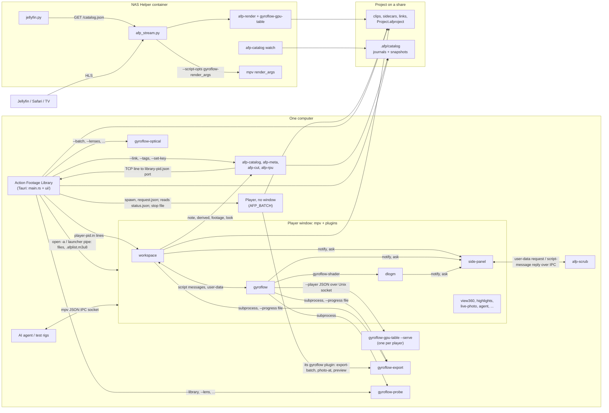

# Architecture
Covers: `mpv/scripts/`, `vs-gyroflow/`, `catalog/`, `library/`, `tools/nas-helper/`, `tools/stream/`, `shaders/`, `macos/`, `windows/`

Checked against 295101c (2026-11-25).

The system as it is. The contracts between its processes are in [contracts.md](contracts.md); the files it keeps on
disk are in [files-and-formats.md](files-and-formats.md); how a setting travels from a key to a render is in
[settings-flow.md](settings-flow.md). The rules every change follows are in [../../CLAUDE.md](../../CLAUDE.md).

## The parts

| Part | What it is | Where |
|---|---|---|
| Player | mpv (0.42, or our own build) with 12 Lua plugins, `vo=gpu-next` | `mpv/scripts/`, `macos/player.sh`, `windows/launcher/` |
| vs-gyroflow | Rust: the stabilization engine on gyroflow-core, and the binaries the player runs | `vs-gyroflow/` |
| Catalog | Rust crate `afp-catalog`: the project, its journal and snapshots, the safeguards | `catalog/` |
| Library | Action Footage Library, a Tauri app (Rust + a JS page). Links `afp-catalog` only | `library/` |
| NAS Helper | One Docker container: catalog watch, the HLS stream, Jellyfin links | `tools/nas-helper/`, `tools/stream/` |

The Library never links vs-gyroflow or mpv. It runs them as processes: the player in batch mode (`AFP_BATCH`),
`gyroflow-probe`, `gyroflow-optical`, `afp-meta`, `afp-cut`.

### The player's plugins

Each plugin is a folder in `mpv/scripts/` that works without the others. Plugins talk to each other through script
messages and `user-data/` properties (lists in [contracts.md](contracts.md#generated-lists)). The app loads them all
with `--script=` from `Contents/Resources/plugins/` (`macos/player.sh`; on Windows `windows/launcher`).

| Plugin | What it does | Notable modules |
|---|---|---|
| `workspace` | The project a clip belongs to, its moments, tags, clip previews, batch mode, the inbox from the Library | `workspace.lua` (project lookup, twin of `workspace.rs`), `projectfile.lua`, `projectcache.lua`, `sidecar.lua` (`<clip>.afp.json`), `transform.lua` (source and transform settings), `moments.lua`, `link.lua` (the MP4 link reader), `tags.lua`, `cut.lua` (Ctrl+x), `librarylist.lua` (a list from the Library as the playlist), `journal.lua` (responsiveness journal), `longpath.lua` (Windows MAX_PATH) |
| `gyroflow` | Stabilization on the GPU path, export, photos, Save frame, crop mode, quality fallbacks | `main.lua`, `ahead.lua` (table kept ahead of playback), `export.lua` (runs `gyroflow-export`), `exportsettings.lua`, `still.lua` (Ctrl+p denoise switch), `dnstep.lua` (frame steps under the denoise), `quality.lua`, `crop.lua`, `gestures.lua`, `measure.lua` (Ctrl+m), `projectwatch.lua` (Ctrl+e), `platform.lua`, `gpu_hold.glsl`, `chromatic.glsl`, `underwater.gyroflow` |
| `dlogm` | Log curves and looks: log → HDR, SDR looks, Dolby Vision, underwater colour | `main.lua`, `dji_color.lua`, `gopro_color.lua`, `video_color.lua` (the `colr` box), `uwcolor.lua` + `uw_estimate.lua`, `dv/` (shipped RPUs and their look) |
| `view360` | 360° clips as a view to look around in, and the recorded view | `view360.glsl`, `view.lua` (its geometry in Lua), `recording.lua` |
| `side-panel` | The settings panel beside the video, the navigation bar, cards and dialogs | `ui.lua`, `bar.lua` + `timeline.lua`, `notify.lua` + `notify_client.lua` (what other plugins load), `scrub.lua` (seek-bar pictures via `afp-scrub`), `tagchips.lua`, `lensdialog.lua`, `exportkind.lua`, `navkeys.lua` |
| `live-photo` | Photos shown as a phone shows them, Live and Motion Photos | `live.lua` |
| `highlights` | Camera highlights and the user's marks on the seek bar | `markers.lua` (reads them from the MP4) |
| `dji-telemetry` | Depth, pressure, GPS, exposure over the video (DJI, GoPro, drone `.SRT`) | `telemetry.lua` |
| `footage-menu` | The right-click menu for the plugins | — |
| `agent` | Notes for an AI agent (Ctrl+r) and the IPC socket it reaches the player by | — |
| `any-layout` | Keys work in a Cyrillic keyboard layout | — |
| `sdr-check` | macOS only: says when an SDR monitor is set up as HDR | runs `macos/sdr-check.swift`'s binary |

The Windows app carries the first 11 (`windows/launcher/src/main.rs` `PLUGINS`); `sdr-check` is in the Mac app only.

### vs-gyroflow

The library (`vs-gyroflow/src/lib.rs`'s `Engine` and `Views`) loads a clip with gyroflow-core and renders it. The
export's pipes path renders with it. gyroflow-core comes from a fork of Gyroflow 1.7.0 (`vs-gyroflow/Cargo.toml`
says which commits are on top and why). The modules by area:

- **GPU warp:** `gpu_table.rs` (the per-frame table, `PlayerClip`, `unsupported`), `edges.rs`, `sphere.rs`,
  `smooth.rs` (edge fill), `dispersion.rs` (fringes under water), `translation.rs` (Ctrl+j), `motion.rs` and
  `prefetch.rs` (motion data read in stretches), `smoothing.rs`, `levels.rs`.
- **What a clip is:** `probe.rs`, `water.rs`, `in_camera.rs`, `markers.rs`, `geotag.rs`, `mp4meta.rs` (MP4 keys,
  the link), `xmp.rs` (a photo's link and tags), `workspace.rs` (re-exports `afp_catalog::workspace`, the one Rust copy of the
  lookup that `workspace.lua` twins).
- **Lenses:** `lens_pick.rs` (Gyroflow's database, the curated list in `resources/curated_lenses.json`, the user's
  list), `lens_db.rs` (the player's own database), `lens_find.rs` (Find and Estimate lens).
- **Optical motion:** `optical.rs`, `measure.rs`, `afp_motion.rs` (`<stem>.afp-motion`).
- **Export:** `user_shader.rs` (the player's mpv shaders on wgpu), `gpu_lut.rs`, `uwcolor.rs`, `still.rs` and
  `photo.rs`, `dovi.rs` and `dv_mux.rs` (Dolby Vision), `youtube.rs`, `cut.rs`.
- **360:** `rig.rs`, `rig_masks.rs`, `sphere360.rs`, `stamp.rs`, `heading.rs`, `nav.rs`, `view360.rs` +
  `view360.wgsl`, `export360.rs`, `reframe.rs`.
- **Misc:** `project.rs` (the project written for Ctrl+e), `tools.rs` (which ffmpeg).

The binaries in `vs-gyroflow/src/bin/`:

| Binary | Who runs it | What for |
|---|---|---|
| `gyroflow-gpu-table` | gyroflow plugin (`--serve`, `--player`, `--sphere360`); afp-stream (`--player`) | The warp shader for a clip; a per-player table server on a Unix socket |
| `gyroflow-export` | `export.lua`; Finder Quick Action (`macos/export-finder.sh`); Windows `--export` | Exports, photos, Live/Motion Photos, moment files, previews, 360 exports |
| `gyroflow-probe` | gyroflow plugin; view360; the Library (`--library`, `--lens`, `--save-lens`, `--assign-lens`, `--forget-lens`) | What a clip can be stabilized with, its color, lens, camera, marks, clock, GPS |
| `gyroflow-optical` | gyroflow plugin (Ctrl+m, lens dialog); the Library (`--batch`, `--lenses`, `--lens-types`, `--lens-for`, `--keep-lens`, `--promote-lens`) | Motion measured from the picture; Find and Estimate lens |
| `gyroflow-project` | gyroflow plugin (Ctrl+e) | The Gyroflow project the player plays a clip with, written beside it |
| `afp-cut` | workspace plugin (Ctrl+x); the Library (`--set-key`) | Lossless cut; an MP4 key written in place |
| `afp-meta` | workspace plugin (photo links); the Library | A file's link and tags read and written |
| `afp-catalog` | workspace plugin; NAS Helper (`watch`) | The project's catalog from the command line |
| `afp-rpu` | dlogm plugin (dv trims); `tools/make_dv_rpu.sh` | Dolby Vision RPUs for a look |

`catalog/src/bin/afp-catalog.rs` builds the same tool from the catalog crate alone, for the NAS image.

Helpers that aren't Rust: `afp-scrub` (`tools/scrub/afp-scrub.c`, the seek-bar pictures), `afp-photo`
(`macos/photo.swift`, HEIC with a gain map, also writes a HEIC's XMP for `afp-meta`), `sdr-check`
(`macos/sdr-check.swift`). The Library app carries `afp-thumbs`, `afp-quicklook` and `afp-photos` (`macos/thumbs.swift`,
`quicklook.swift`, `photos.swift`).

### Catalog

`catalog/` (`afp-catalog`) keeps what's in a project's folder and locations, shared through `.afp/catalog/` on the
share: each computer appends to its own journal (`journal.rs`), the Library folds snapshots (`snapshot.rs`,
`catalog.rs`). `workspace.rs` is the one Rust copy of the workspace lookup and of a clip's own file (vs-gyroflow
and the Library both use it; `workspace.lua` is its Lua twin), with `locations.rs`; `registry.rs` reads
`mpv/scripts/workspace/registry.json`, the one list of curves, export choices, setting keys and own folders. `live.rs` is how programs on one computer tell
each other at once ([contracts.md](contracts.md#the-live-channel-library-and-player-on-one-computer)). `care.rs` and
`inspect.rs` are the safeguards ([../design/catalog-safeguards.md](../design/catalog-safeguards.md)). `finder.rs` writes Finder tags.
`sim.rs` simulates a NAS for the tests in `catalog/tests/`. The design is
[../design/library-management.md](../design/library-management.md) §9.

### Library

`library/src/` is the app's Rust side. `main.rs` is the wiring: the state the commands share (`Inner`, `Job`), `main()`
and `generate_handler!`'s list of every command. The commands live in a module per area, each `use`d whole by
`main.rs` (`pub(crate)` for what another module calls):

| Module | What |
|---|---|
| `project.rs`, `recent.rs`, `settings.rs`, `moving.rs`, `watching.rs` | The project: its file (`read_doc`, `update_doc`), opening it, this computer's list of projects, its locations and caches, moving it, its folder watched |
| `batch.rs` | The player run without a window: the job queue (`add_job`, `start_job`, `tick`), Share's runs |
| `browsing.rs`, `items.rs`, `playing.rs` | The views read (`scan`, `cached_view`); what's done to items (take in, rename, delete, new folder); opened in the player |
| `care.rs`, `tagging.rs`, `lens.rs` | Check, Find moved, Mend; tags, picks, ratings; the lens and Source settings |
| `index.rs` | The views (footage, moments, stills, exports) read from the files; the probe queue (`gyroflow-probe --library`, `GEOTAG`) |
| `seen.rs` | The catalog in the Library: what changed, noted, and told to player windows |
| `renders.rs` | The render cache: recipe, hash, `BUNDLE_KEYS`, `EXPORT_CHOICES` |
| `share.rs` | Share: renders from the cache, the rest asked of the player (batch `share`) |
| `tags.rs` | Tags and culling (twin of `tags.lua`) |
| `albums.rs`, `changed.rs`, `checks.rs`, `geo.rs`, `takein.rs`, `thumbs.rs`, `journal.rs`, `perf.rs` | Albums, pinpoint updates, Check/Find moved files, locations from Apple Photos and GPS, Take in, thumbnails, the journal, the perf rig |

`library/ui/` is the page: `app.js` (the window), `tiles.js`, `albums.js` + `albumviews.js` + `timeline.js` +
`map.js`, `culling.js`, `share.js`, `lenses.js`, `writes.js` + `changes.js` (screen first, disk after), `history.js`,
`journal.js`, `atstart.js`. `library/ui-tests/` runs the page in jsdom against a mock (`npm test`); `library/tests/`
holds the headless-Chrome screenshot scripts.

In the page:

- **Script order** (`ui/index.html`): `journal`, `writes`, `changes`, `albums`, `tiles`, `albumviews`, `timeline`,
  `map`, `culling`, `atstart`, `share`, `lenses`, `history`, `app` last. A script may use a later one's names only
  inside functions.
- **Albums** are folders: one album name stands for `_Clips/<name>`, `_Moments/<name>` and `_Stills/<name>`
  (`albums.js` `albumShown`, `albumRealDirs`); what's added from the Library goes to `_Clips/<name>`. A new kind of
  item is a source in `ALBUM_SOURCES` and a line in `ALBUM_KINDS`. "My albums" is a place in the page only.
- **Views inside Albums that aren't folders** (Timeline, Map, My albums, the media types) are entries of `ALBUM_VIEWS`
  (`[id, label, draw, items, meta]`; `draw: null` lets `renderMain` draw). Such a view is `S.view = "footage"` with
  `S.path[0]` its label behind `AV_MARK` (a zero-width space), so a user's album named "Timeline" stays an album.
- **Dates and places** are each item's `when` and `geo` (`app.js` `deriveItems`, `deriveGeo`): an original's
  recording time; a moment's or photo link's is its clip's start + `in` / `t`; a rendered photo's its mtime. A place
  is the original's `location`, else the camera's GPS named through `places.json`; moments and photos take their
  clip's. A trip (`timeline.js` `tlModel`) is two days or more in a row at one wider place, one empty day allowed.
- **Map** draws with Leaflet 1.9.4 (`ui/vendor/leaflet/`) and OpenStreetMap's tiles (`map.js` `MAP_TILES`, allowed by
  the CSP's `img-src` in `tauri.conf.json`); pins are 84 px Web Mercator cells. Offline, it shows the Places list.
- **The pinned bar** above every list is `.mbar`, the first child of `#main`; `pinBar()` measures it into `--mbar-h`
  for Timeline's sticky day headers.
- **Photo links made by the Library** are the frame as recorded (`albums.rs` `frame_at`, the player's ffmpeg, at most
  1280 px), not stabilized; the player's (`Alt+s`) are the frame as shown.
- **Renders:** only the Library hashes a recipe; it hands the player the output file and the link. A clip with nothing
  to change (not log, nothing to stabilize) is copied as it is, a moment cut losslessly by `afp-cut` (`share.rs`
  `as_recorded`). An SDR clip's HDR render is its SDR one (`renders.rs` `find_with`).

### NAS Helper and stream

`tools/nas-helper/helper.py` runs, as `nas_settings.py` says, up to three parts, each its own process restarted when it
stops: `afp-catalog watch <project>` per project, `tools/stream/afp_stream.py`, and `tools/stream/jellyfin.py`. Its
status is `/data/helper.json` in the container. The NAS runs only what Anton starts: nothing renders or scans in the
background unless asked ([../../CLAUDE.md](../../CLAUDE.md)). Details: [../../tools/nas-helper/README.md](../../tools/nas-helper/README.md),
[../../tools/stream/README.md](../../tools/stream/README.md).

## Processes and who talks to whom



### Inside one player

- **Plugins to plugins:** script messages (`script-message-to <plugin> <msg> <args>`) and `user-data/<plugin>/…`
  properties. The workspace plugin publishes `user-data/workspace` (the clip, its project, moment, offset); the
  gyroflow plugin publishes `user-data/gyroflow/*` (its state, `exporter`, `defaults`, `export_settings`); dlogm
  publishes `user-data/dlogm`. Every message has its `register_script_message` and every `user-data` read is written
  somewhere: `tests/script_messages_test.py`, `tests/user_data_test.py`.
- **Cards and dialogs:** plugins load `side-panel/notify_client.lua`, which turns `mp.notify` and `mp.ask` into
  `script-message-to side_panel notify|ask` ([../design/notifications.md](../design/notifications.md)).
- **The warp in the shader list:** the gyroflow plugin tells dlogm `gyroflow-shader <old> <new>`; dlogm keeps its own
  list of file-local `glsl-shaders` and puts the warp first, its look after it.

### Subprocesses the player starts

All through mpv's `subprocess` command, asynchronously.

- `gyroflow-gpu-table --serve <socket>` once per player (not on Windows: a Unix socket). It exits when its parent is
  gone or after an hour idle.
- `gyroflow-gpu-table --player <json> <out.glsl> [--server <socket>]` for each warp: the clip opening, a setting
  changed, the table extended ahead of playback. One JSON line back
  ([contracts.md](contracts.md#the-player-and-gyroflow-gpu-table)).
- `gyroflow-probe <video>` as a clip loads (one JSON line); `--lens`, `--headings`, `--reframe` later.
- `gyroflow-export` for Shift+E, `preview` (a moment file), `photo`, `photo-full`, `photo-at`, `export-batch`. It
  writes its progress to a file twice a second; background priority by SIGUSR1/SIGUSR2 (a control file on Windows).
- `afp-catalog note` after every write; `afp-catalog derived|footage|list|look --own` for reads, never blocking
  playback.
- `afp-cut`, `afp-meta`, `afp-rpu`, `gyroflow-optical`, `gyroflow-project`, `ffmpeg` for their features.
- `afp-scrub --ipc <socket>`: long-lived. It reads requests from `user-data/afp-scrub/request` and answers with
  `script-message-to side_panel scrub <reply>` over the player's IPC socket (the agent plugin's, else its own).
- `osascript` once, for macOS's EDR headroom (HDR or SDR screen).

### The Library and the player

- **Opening items:** `open_items` and `open_list` in `library/src/playing.rs`. macOS: `open -a <ActionFootagePlayer.app>
  <files>` (Apple Events reach the running mpv; a video opened while one plays replaces it). Windows: the launcher sends
  the files down the player's pipe `\\.\pipe\ActionFootagePlayer`, and the Library polls `get_property path` on that
  pipe until it plays. A list is an `.afplist.m3u8` file that `workspace/librarylist.lua` reads into the playlist.
- **Batch:** the Library starts the player with no window and `AFP_BATCH=<request.json>`, one job at a time, and reads
  the status file it writes ([contracts.md](contracts.md#the-librarys-batch-afp_batch)). `gyroflow-optical --batch`
  takes the same request/status shape for Stabilize optically, Find lens and Estimate lens.
- **Changes both ways, on one computer:** the player notes writes through `afp-catalog note`, which sends the Library
  a TCP line; the Library appends a line to each player window's inbox `player-<pid>.in`
  ([contracts.md](contracts.md#the-live-channel-library-and-player-on-one-computer)). Between computers, the catalog's
  journals on the share carry the same.
- **Journal hand-off:** `journal.rs` writes `handoff.json` (which click opened which files) and gives a batch player
  `AFP_JOURNAL_PARENT`; `workspace/journal.lua` reads both ([../design/responsiveness-journal.md](../design/responsiveness-journal.md)).

### The NAS Helper

The Library and the player never talk to the NAS Helper directly. They meet in the project's files and its catalog on
the share. `afp-catalog watch` keeps the catalog current from the NAS's side. `afp_stream.py` asks a headless mpv with
the player's own plugins how each file plays (`--script-opts-append=gyroflow-render_args=<file>`), gets the warp from
`gyroflow-gpu-table --player` with the same request, and renders HLS with `afp-render` (VAAPI → libplacebo → hevc_vaapi).
`jellyfin.py` reads the stream's `/catalog.json` and writes `.strm` and `.nfo` files for a Jellyfin library.

## How a frame is drawn

1. **Open.** The workspace plugin finds the project and publishes `user-data/workspace`. The gyroflow plugin runs
   `gyroflow-probe`. A clip with motion data opens paused on black (`gpu_hold.glsl`) while its warp is written.
2. **Decode.** mpv decodes on the GPU (`hwdec=auto` in `mpv/app.conf`).
3. **Warp.** `gyroflow-gpu-table` writes `shaders/gyroflow/warp.glsl` with the clip's table (each frame's parameters and
   row rotations as quaternion knots) as a texture. libplacebo runs it at `MAIN` (grid mode) or at `LUMA` and `CHROMA`
   (planes mode), finding the frame by mpv's PTS. It renders at the size of the video's rectangle on screen, so it is
   the scaler. Inside it, as asked: the fringes under water, the edge fill (sphere or smooth), the temporal denoise
   (`dn_` passes, Ctrl+p), the translation compensation (Ctrl+j). Interpolation: Lanczos up to 31 fps, bicubic above
   (`gyroflow/main.lua` `interpolation`). `gyroflow-gpu-table` assembles `warp.glsl`'s sections by mode: the player
   gets grid (RGB at `MAIN`, a table point every `--grid-step` px, 16 by default) when it needs RGB (fringes, the
   edge fill), else planes (`reply.mode`); `exact` is for checks. 33 rotation knots a frame (`--knots`) are at the
   noise floor. The table is a 16384-wide `rgba32f` texture (`gpu_table::MAX_TEX`): per frame 16 parameter texels and
   its knots.
4. **Look.** dlogm's shader at `HOOK MAIN`, after the warp: a log curve's LUT to Rec.2100 HLG, the underwater colour,
   DJI's LUT, NBCU's HLG/PQ → SDR, or none. It tags the video with a `format` filter so mpv's color pipeline is an
   identity ([D-Log M](#d-log-m)).
5. **360.** A 360 camera's file: `gyroflow-gpu-table --sphere360` makes the sphere; `view360.glsl` draws the view from
   it at the screen's rate.
6. **Out.** `target-colorspace-hint=yes` switches the display to HDR. The dv looks go through macOS's sample-buffer
   layer with a Dolby Vision RPU per frame (our mpv's patches in `tools/mpv-patches/`).

A clip the warp can't do (`gpu_table.rs` `unsupported`: Sony's lens model or the generic polynomial, a lens mesh,
IBIS/OIS, a sideways rolling shutter, an equirect output), and every clip in an mpv older than 0.42 or with a `vo`
other than `gpu-next`, plays as recorded with a card saying why. Details: [../design/gpu-render.md](../design/gpu-render.md),
[../design/gpu-table-ahead.md](../design/gpu-table-ahead.md).

### 360° clips

- **The tracks:** a 360 camera's two lens tracks are joined side by side, on the GPU by the app's mpv (`--video-join`,
  patch 0014), elsewhere by `lavfi-complex` `hstack` with copy decoding; each track is decoded on a thread of its own
  (`vd-queue-enable=yes`, `gyroflow/main.lua`).
- **The sphere:** `gyroflow-gpu-table --sphere360`, 5760 wide by default (`sphere360::DEFAULT_WIDTH`;
  `gyroflow.conf` `sphere_width`), with the angles stamped under it for `view360.glsl`. `sphere360.rs` makes the same sphere for
  exports.
- **Gravity:** the gyro is integrated alone, and the vertical is the accelerometer averaged ±20 s (`heading.rs`
  `GRAVITY_SIGMA_S`): an AHRS that trusts the accelerometer within seconds follows a leaning motorcycle off.
- **The view** is drawn at the screen's rate. While it's on, `view360/main.lua` `pace` sets `video-timing-offset` to a
  refresh + 4 ms and, with the app's mpv, `macos-display-sync=fullscreen` (patch 0013); patch 0012 turns the view by
  the trackpad's gestures in the VO. `tools/latency360/` measures input to light.
- **Time and place:** Insta360's `first_gps_timestamp` is unix ms at the video's start (`nav.rs`); the GPS lag is
  fitted within `LAG_SEARCH_S`. A 360 export is marked equirect by `mp4meta.rs` `write_spherical` (V2 `st3d`/`sv3d`
  and V1 XMP), which ffmpeg's command line can't write.

## How an export runs

1. Shift+E (or a batch, or the Library's Share) asks `export.lua`. It builds `gyroflow-export`'s arguments from what
   plays: the curve, look, view, level, edges, denoise, lens, project, part (`--from`, `--to`), and the export settings
   (`exportsettings.lua`). The flags list is [generated](contracts.md#gyroflow-export-flags).
2. With the workspace plugin it asks the name (`export-name`), then starts (`export-start`); the file goes to the
   project's `_Exports/Generated/` (`moments.lua` `generated_rel`) with its link inside (`--link`). `gyroflow-export`
   run alone writes to the project's `_Exports/`, else `stabilized/` beside the clip.
3. `gyroflow-export` picks a path. **GPU path** (`--gpu auto`, the default where it can): one ffmpeg, hardware decode
   → the libplacebo filter running the player's own shaders (`gpu_table::for_libplacebo`, the look baked from the
   `.cube`) → hardware encode. **Pipes path** otherwise: ffmpeg decode → `Engine` on wgpu → LUT (`gpu_lut.rs`) and the
   player's other shaders (`user_shader.rs`) → ffmpeg encode, raw frames over pipes. It says why it fell back.
4. Progress goes to the `--progress` file; `export.lua` shows it and puts the export at background priority while
   video plays. The `  -> <file>` line on stderr names the result; `export.lua` notes it in the catalog.

Photos (`--photo`, `still.rs`, `photo.rs`, `afp-photo` for HEIC) and moments (`--preview still`) are the same tool.
Details: [../design/export-gpu-path.md](../design/export-gpu-path.md), [../design/export-settings.md](../design/export-settings.md).

## Log curves and looks

### D-Log M

DJI tags D-Log M files as BT.709 SDR and names Normal-color clips `*_D.MP4` too. The color profile is in DJI's own
metadata: `ColorMode` in the stream metadata of the `CAM meta` track (19 is D-Log M, 2 is D-Log). The dlogm plugin
reads it in Lua (`dlogm/dji_color.lua`: the first sample of the metadata track, a few protobuf fields) for the Osmo
Action 6 and Osmo 360, whose layouts are known; other models' clips play as they are. `gyroflow-probe` reads it the
same way for the export.

The plugin sets the shader and display options as file-local options, added to any of the user's own, so mpv undoes
them when a playlist moves to a clip that isn't log. The looks (`dlogm/main.lua`'s header has the full list):

- `hdr`: a 65³ D-Log M → Rec.2100 HLG (1000 nit) LUT (`luts/dlogm_hlg.cube`, from Zeb Gardner's D-Log M → DaVinci
  Wide Gamut/Intermediate shaper) at `HOOK MAIN`. A `format` filter tags the video HLG/BT.2020 and the target is the
  same, so mpv runs an HLG → HLG identity. `target-colorspace-hint=yes` switches the Metal layer to HDR.
- `dv`, `dvsdr`: the hdr look's HLG shown by macOS's video layer with a Dolby Vision RPU on each frame
  (`dlogm/dv/nbcu_fit.rpu`, trims fitted to NBCU's conversion; each frame's L1 measured live by default). `dvsdr`
  always tones down to SDR. Only with the app's mpv.
- `tonemap`: the hdr look's HLG tone-mapped to SDR by libplacebo.
- `nbcu`: the hdr look, then NBCUniversal's 33³ HLG → SDR conversion (`luts/3-NBCU_HLG2SDR_DL_v1.2.cube` baked by
  `shaders/nbcu_sdr.glsl.in`). NBCU's are Type III LUTs and the shader interpolates tetrahedrally from the texels.
- `maker`: DJI's 33³ D-Log M → Rec.709 LUT (downloaded from DJI at setup, `shaders/dlogm_lut3d.glsl.in`).
- `off`: as recorded (L).

A file tagged HDR (HLG or PQ, read from its `colr` box by `video_color.lua`) plays in HDR as it is, never as log. Its
SDR looks are NBCU's for its transfer (`nbcu_hlg2sdr.glsl`, `nbcu_pq2sdr.glsl`), tonemap, or dv with its own profile 8
RPU when it has one.

Which look a clip starts in depends on the screen: macOS's EDR headroom, asked once with `osascript`. On an HDR screen
`hdr`; on an SDR screen the SDR look last chosen (at first `dv` with the app's mpv, `tonemap` without). On Windows and
Linux, or when it can't tell, every screen counts as HDR. A clip keeps its look when its window moves.

The LUTs are baked into shaders as 3D `rgba16` textures (`tools/cube_to_glsl.py`, templates in `shaders/*.glsl.in`), so
the GPU interpolates trilinearly in one tap.

### Other log curves

D-Log, GP-Log, GP-Log2 and 10-bit I-Log get the same `hdr` look: a 65³ LUT to Rec.2100 HLG at `HOOK MAIN`
(`shaders/log_hlg.glsl.in`). D-Log's, GP-Log2's and I-Log's LUTs aren't in the repo: `tools/make_hdr_lut.py` makes them
at install from each maker's publication ([../design/luts.md](../design/luts.md)):

| Curve | Decoding, and the gamut | From |
|---|---|---|
| DJI D-Log | DJI's `dlog_to_lin`, D-Gamut | DJI's ACES input transform (`Dlog_DGamut_to_ACES_AP0_cat02_v1`) |
| GoPro GP-Log2 | log base 600, +1.8 EV (18 % grey at 0.542), Rec.2020 | GoPro Labs' GP-Log2 LUT Generator (formulas reimplemented) |
| Insta360 10-bit I-Log | the white paper's I-Log to scene-linear, BT.2020 | Insta360's 10-bit I-Log White Paper (2026) |

From scene light every curve is rendered as `luts/dlogm_hlg.cube` renders D-Log M: scaled by 0.254, rolled off by
`x / (1 + (x/0.69)^1.5)^(2/3)` (fitted to that LUT; 18 % grey at about 37 % HLG), then HLG-encoded in Rec.2020.

GoPro publishes no gamut for GP-Log, so `luts/gplog_hlg.cube` comes from Zeb Gardner's GP-Log → DWG/I shaper with the
same rendering (`make_hdr_lut.py --from-dwgi`). GoPro moved GP-Log's exposure with firmware, so only HERO12 Black 1.20
and later and HERO13 Black are taken for GP-Log by themselves (`dlogm/main.lua` `GPLOG_FIRMWARE`); others play two
stops off and need Ctrl+l.

Which curve a clip is in: DJI's `ColorMode`, GoPro's Protune `PTCL` with the camera and firmware
(`dlogm/gopro_color.lua`), or Ctrl+l. The curve list is the registry's (`mpv/scripts/workspace/registry.json`), read by the player, gyroflow-export
and the Library; what's still kept apart is listed in
[../../CLAUDE.md](../../CLAUDE.md) ("Curves").

### Underwater colour

For plain SDR clips (GoPro's and the like), the `uw` curve: `shaders/underwater_hlg.glsl` corrects the frame and makes
it HLG in Rec.2020, so every look takes it from there. `dlogm/uwcolor.lua` measures the frame a few times a second
(`uw_estimate.lua` has the rule) and eases the shader's `glsl-shader-opts`. The export measures the same way
(`vs-gyroflow/src/uwcolor.rs`).

## Gyroflow

The gyroflow plugin (`gyroflow/main.lua`) asks `gyroflow-gpu-table` for the clip's warp: Gyroflow's own render of the
project (smoothing, zoom, lens, horizon) as an mpv shader. Without a `.gyroflow` beside the video, `gyroflow-probe`
decides whether the clip has its own motion data recorded with the camera's stabilization off (each camera's rule:
`vs-gyroflow/src/probe.rs`), or a GoPro HERO12+ HyperSmooth record (`in_camera.rs`), or motion measured from the
picture (`<stem>.afp-motion`, Ctrl+m or the Library's Stabilize optically: [../design/optical-without-gyroflow.md](../design/optical-without-gyroflow.md)).
Such a clip plays with Gyroflow's default preset, then `default.gyroflow` (`underwater.gyroflow` ships as it).

A clip without a project starts from a stretch of its motion data and the table is extended ahead of where it plays
(`ahead.lua`, `gpu_table.rs` `motion_range`): from a NAS the whole motion data of a big clip took seconds.

gyroflow-core is Gyroflow 1.7.0 from a fork (static zoom modes, `view_rotation` for crop mode's pan, equirect output and
`RigLens`, Insta360 terms, lens from video). Up to 2026-11 there was also a VapourSynth path; it was taken out.
More: [../../vs-gyroflow/README.md](../../vs-gyroflow/README.md).

## Telemetry

`dji-telemetry/telemetry.lua` reads the metadata track (the first with a `meta` handler, as for D-Log M) through its
sample table (`stts`, `stsc`, `stsz`, `stco`/`co64`), a chunk of samples at a time, and decodes only the values shown.
Each value is kept only where it changes; `main.lua` looks it up by `time-pos` and redraws the OSD overlay (ASS) when
the text changes. A 3.7-minute 4K60 clip (2.5 GB) is read in 0.4 s.

- **DJI:** one protobuf `ProductMeta` per frame (`dvtm_*.proto`), read along paths of field numbers per model
  (`LAYOUTS`, by `proto_file_name`). On the Action 6 the barometer is at `3.2.13`; GPS at `3.4.2` (from the Osmo 360's
  schema, not checked against a recording with a fix).
- **GoPro:** GPMF, nested KLV (`DEVC` → `STRM` → `GPS5`, `SHUT`, …), big-endian, each scaled by the `SCAL` before it. A
  sample holds about a second, spread evenly. GPS5 (HERO5-10) has the fix for the sample in `GPSF`; GPS9 (HERO11+) per
  row.
- **DJI drones:** the `.SRT` beside the clip, or the subtitle track, a line per frame (`M.parse_srt`).

## Highlights and marks

`highlights/markers.lua` walks the file's boxes with seeks (mdat isn't read):

- **DJI** (Osmo Action 4, 5 Pro, 6): a top-level `free` box that starts `data`, then a box `hglg` (32-bit big-endian
  size, its type, 5 bytes), then 5 bytes per highlight: a byte, and the time in ms, 32-bit little-endian. The layout
  is ExifTool's (`HighlightMarkers`).
- **GoPro HERO5, HERO6:** `moov/udta/HMMT`: the count, then each time in ms, 32-bit big-endian. FFmpeg makes chapters
  of these already; the plugin gives them titles rather than adding them twice.
- **GoPro HERO7 and later:** `udta`'s `GPMF` box, the `DEVC` whose `DVID` is `HLMT`: one struct per highlight as its
  `TYPE` lays it out; the time is the first field.

`main.lua` adds them to mpv's `chapter-list` beside the file's own chapters; its keys seek `before=` seconds early. Once
the user changes a mark (M), the marks live in the clip's `<clip>.afp.json` ([files-and-formats.md](files-and-formats.md)).

## Layout

Every path below exists at 295101c.

```
CLAUDE.md                      the rules every session follows
README.md                      what it does and how to install it
install.sh                     builds and installs the plugins (and --apps: the Mac apps)
mpv/
  app.conf                     the apps' own mpv settings
  mpv.conf                     recommended settings, installed when there's no mpv.conf
  scripts/<plugin>/            the 12 plugins (table above); each → ~~/scripts/<plugin>, and into the apps.
                               gyroflow/ gets the vs-gyroflow binaries at install, dlogm/ its shaders/ and luts/
shaders/
  gyroflow/warp.glsl           the warp template gyroflow-gpu-table fills
  gyroflow/lens/               Gyroflow's lens models as GLSL, included into the warp
  dlogm_hlg.glsl.in            D-Log M → HLG template (the LUT goes in at install)
  log_hlg.glsl.in              any log curve → HLG template
  dlogm_lut3d.glsl.in          DJI's Rec.709 LUT template
  nbcu_sdr.glsl.in             NBCU HLG/PQ → SDR template
  underwater_hlg.glsl          underwater colour
  denoise.glsl                 the old playback denoise (off; dlogm.conf denoise=yes)
  stamp_probe.glsl             360 stamp check, not part of the player
luts/                          dlogm_hlg.cube, gplog_hlg.cube, NBCU's HLG→SDR and PQ→SDR
vs-gyroflow/
  src/lib.rs, src/*.rs         the engine and its modules (above)
  src/bin/                     gyroflow-gpu-table, gyroflow-export, gyroflow-probe, gyroflow-optical,
                               gyroflow-project, afp-cut, afp-meta, afp-catalog, afp-rpu
  resources/                   curated_lenses.json, lens_ratings.txt, lenses/ (the player's lens profiles)
  tests/                       integration tests (export_gpu, photo_dates, table_ahead)
catalog/
  src/                         the afp-catalog crate; bin/afp-catalog.rs for the NAS image
  tests/                       safeguards, scenarios, random and cost tests on the simulated NAS
  examples/rig.rs, Dockerfile  the NAS-side rig, the catalog's own image
library/
  src/                         the Library's Rust side (main.rs, index.rs, renders.rs, …)
  ui/                          the page (app.js, tiles.js, albums.js, share.js, …); ui/vendor/ third-party JS
  ui-tests/                    the page in jsdom against a mock (npm test)
  tests/                       headless-Chrome screenshot scripts and their mocks
  tauri.conf.json, capabilities/, icons/, build.rs
macos/
  player.sh                    the Mac app's executable: mpv with the plugins
  finder-launch.lua, setup-offer.lua, setup.sh, default-app.py, export-finder.sh
  photo.swift                  afp-photo (HEIC with a gain map)
  sdr-check.swift              sdr-check
  thumbs.swift, quicklook.swift, photos.swift   the Library's afp-thumbs, afp-quicklook, afp-photos
  icon/                        AppIcon.svg, AppIcon.icns
windows/
  launcher/                    ActionFootagePlayer.exe (Rust): starts mpv, the IPC pipe, --batch, --export
  setup.py, installer.iss, AppIcon.ico, THIRD-PARTY.txt
tools/
  build_mpv.sh, mpv.lock       our mpv build; mpv-patches/, libplacebo-patches/ its patches
  dev_app.sh                   a trial app built as the release does, into ~/Applications
  make_app.sh, make_library_app.sh, make_windows_app.sh, make_release.sh, make_plugin_zip.sh,
  make_plugin_bundles.py, bundle_runtime.py, make_icon.sh, make_library_icon.sh, png_to_ico.py,
  make_workflow.py             packaging, icons, Finder Quick Actions
  cube_to_glsl.py, make_hdr_lut.py, make_dv_rpu.sh   LUTs and RPUs
  run_tests.sh                 every tests/*_test.* by name
  gen_reference.py             the generated lists in docs/reference/contracts.md
  journal_report.py            where the waiting is, from the responsiveness journal
  nas-helper/                  the NAS Helper container
  stream/                      afp_stream.py, afp-render.c, jellyfin.py, fmp4time.py, hlsplay.swift, look shaders
  scrub/                       afp-scrub.c and its benches
  pipebench/                   libplacebo pipeline-build timings (live rig)
  export-gpu/                  the zero-copy export spike and our ffmpeg patches
  edgefill/                    the sphere edge fill offscreen (synth/ the model bench)
  latency360/                  the 360 view's input-to-light latency
  sphere360/horizon.py         a 360 rig's axes from the horizon
  one_off/                     one-off migrations, run once by hand (photos_to_links.py, uw_to_source.py)
  dji_meta_dump.py, catalog_rig.py, list_readout_left_out.py, water_dispersion.py, update_lens_ratings.sh
tests/
  *_test.lua, *_test.py, *_test.sh   run by tools/run_tests.sh (CI)
  *_ipc.py, *_e2e.py, photo_link_frame.py, uw_export_check.py   live rigs, not in CI
  workspace_cases.txt, render_settings.json, gyroflow_conf_cases.json, uwcolor_cases.json,
  scrub_sidecar_cases.txt      cases shared by the twins in several languages
  twins.py                     helpers for the guards that read the sources
  make_equirect.py             synthetic 360° clips
docs/                          designs and studies; docs/reference/ these reference pages; docs/img/ pictures
.github/                       pull_request_template.md; workflows/release.yml (the release, and CI for PRs and main)
```
